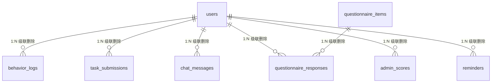

# 数据库说明书

> **文档版本**：v2.0（参照飞书开放平台技术文档规范）
> **适用系统**：人机协作决策实验平台（Human–AI Collaboration Decision Experiment Platform）
> **维护人**：研发组
> **最后更新**：2026-08-05
> **配套文档**：《网站设计文档》《开发文档与实验设计差异对照表》

---

## 更新记录

| 版本 | 日期 | 修改人 | 摘要 |
|------|------|--------|------|
| v1.0 | 2026-08-05 | 研发组 | 初版数据库说明（按 ORM 模型与种子数据整理） |
| v2.0 | 2026-08-05 | 研发组 | 参照飞书开放平台技术文档规范重构：补充文档元信息与更新记录、集中名词解释、强化「重要约定」与「维护注意事项」，并保留 ORM/schema 漂移标注 |

---

## 1. 概述

### 1.1 数据库简介

平台采用 **PostgreSQL** 作为唯一持久化存储，通过 **SQLAlchemy 2.0（异步）** ORM 进行建模与访问。库内共 **10 张业务表**，覆盖参与者账户、行为日志、任务提交、对话历史、问卷、评分、提醒与系统配置。

### 1.2 重要约定（务必先读）

- 平台运行时的数据库结构由 **SQLAlchemy ORM 模型** 经 `Base.metadata.create_all` 自动创建（`backend/app/database.py::init_db`）。因此，**ORM 模型是线上库的真实结构来源**。
- `database/schema.sql` 是一份手工维护的 DDL 参考脚本，**不**参与应用启动建表。经逐字段比对，schema.sql 与 ORM 模型存在一处差异：`admin_scores` 模型额外声明了 `reminder_correct` 列，而 schema.sql 未包含。本文档以 **ORM 模型（线上实际结构）为准**，并在第 4.7 节与第 8 节标注该差异。
- 全文使用 PostgreSQL 语法。建表脚本头部标注 PostgreSQL 16，README 标注 17，二者语法兼容，实际部署以本地 PostgreSQL 版本为准。

### 1.3 名词解释

| 术语 | 说明 |
|------|------|
| ORM | 对象关系映射，本文指 SQLAlchemy 模型 |
| UUID | 全局唯一标识符，用作全部表主键 |
| TIMESTAMPTZ | 带时区的时间戳类型 |
| JSONB | PostgreSQL 二进制 JSON 类型，支持索引与结构化查询 |
| 级联删除 | 删除父记录时自动删除其子记录 |
| Upsert | 存在则更新、不存在则插入的写操作 |

---

## 2. 数据库整体设计

### 2.1 表清单

| 序号 | 表名 | 中文名 | 主要用途 |
|------|------|--------|----------|
| 1 | `users` | 参与者表 | 注册账户、分组、实验状态机、人口统计学信息 |
| 2 | `behavior_logs` | 行为日志表 | 记录参与者全部操作轨迹与交互元数据（核心分析数据源） |
| 3 | `task_submissions` | 任务提交表 | 四项子任务完成标记与产物（docx 路径、提醒时间、邮件状态） |
| 4 | `chat_messages` | 对话消息表 | 参与者与 AI 助理的对话历史（user/assistant/tool） |
| 5 | `questionnaire_items` | 问卷题项表 | 问卷题库（构念、题面、量表类型、适用分组） |
| 6 | `questionnaire_responses` | 问卷作答表 | 参与者对题项的作答值 |
| 7 | `admin_scores` | 管理员评分表 | 研究员对最终行程方案的八因子百分制评分 |
| 8 | `reminders` | 提醒表 | 行程提醒记录与邮件发送状态 |
| 9 | `system_config` | 系统配置表 | 键值对存储实验参数（天数、预算、样本量等） |
| 10 | `admin_users` | 管理员表 | 研究员后台登录账户 |

### 2.2 表间关系（ER 概览）



- **中心实体**：`users`。其余 6 张子表均以 `user_id` 外键关联并级联删除。
- **问卷**：`questionnaire_items`（题库）与 `questionnaire_responses`（作答）为一对多，按 `item_id` 关联。
- **配置**：`system_config`、`admin_users` 为独立实体，不与 `users` 直接外键关联。

### 2.3 通用规范

| 项目 | 说明 |
|------|------|
| 驱动 | `asyncpg`（异步），连接串 `postgresql+asyncpg://…` |
| 初始化 | 应用启动时 `init_db()` 调用 `Base.metadata.create_all` |
| 字符集 | 默认 `UTF8` |
| 时区 | 所有时间字段 `TIMESTAMPTZ`；`created_at`/`updated_at` 默认 `NOW()` |
| 主键 | 全部 `UUID`，默认 `uuid_generate_v4()`（`uuid-ossp` 扩展） |
| 级联 | 用户子表均 `ON DELETE CASCADE` |
| 命名 | 表名 snake_case（`group` 为保留字，以双引号引用 `"group"`）；索引前缀 `idx_<表名>_<字段名>` |

**UUID 扩展**

```sql
CREATE EXTENSION IF NOT EXISTS "uuid-ossp";
```

---

## 3. 表结构详情

> 字段表统一列：字段名 / 类型 / 空 / 默认值 / 约束·说明。

### 3.1 users（参与者表）

存储实验参与者账户、随机分组与实验流程状态。

| 字段名 | 类型 | 空 | 默认值 | 约束 / 说明 |
|--------|------|----|--------|-------------|
| `id` | UUID | 否 | `uuid_generate_v4()` | 主键 |
| `email` | VARCHAR(255) | 否 | — | 唯一索引；登录账户 |
| `password_hash` | VARCHAR(255) | 是 | NULL | bcrypt 哈希；H 组可免密 |
| `"group"` | VARCHAR(10) | 是 | NULL | 实验组：`H` / `SOA` / `MOA`；注册时由分组服务写入 |
| `status` | VARCHAR(50) | 否 | `registered` | 状态机取值：`registered`/`consented`/`demo_completed`/`task_in_progress`/`task_completed`/`questionnaire_completed` |
| `age` | INTEGER | 是 | NULL | 人口统计学：年龄 |
| `gender` | VARCHAR(20) | 是 | NULL | 性别 |
| `education` | VARCHAR(50) | 是 | NULL | 学历 |
| `tech_frequency` | VARCHAR(50) | 是 | NULL | 技术使用频率 |
| `ai_experience` | VARCHAR(50) | 是 | NULL | AI 使用经验 |
| `demo_watch_seconds` | INTEGER | 是 | NULL | 演示视频观看时长（秒） |
| `session_id` | VARCHAR(100) | 是 | NULL | 会话标识 |
| `task_start_time` | TIMESTAMPTZ | 是 | NULL | 任务开始时间 |
| `task_end_time` | TIMESTAMPTZ | 是 | NULL | 任务结束时间 |
| `created_at` | TIMESTAMPTZ | 否 | `NOW()` | 创建时间 |
| `updated_at` | TIMESTAMPTZ | 否 | `NOW()` | 更新时间（`onupdate`） |

### 3.2 behavior_logs（行为日志表）

记录参与者在实验全流程中的操作轨迹，是客观行为指标的核心数据源。含基础字段与「设计七」扩展字段两组。

| 字段名 | 类型 | 空 | 默认值 | 约束 / 说明 |
|--------|------|----|--------|-------------|
| `id` | UUID | 否 | `uuid_generate_v4()` | 主键 |
| `user_id` | UUID | 否 | — | 外键→`users.id` `ON DELETE CASCADE`；索引 |
| `"group"` | VARCHAR(10) | 是 | NULL | 冗余存储分组，便于分析 |
| `timestamp` | TIMESTAMPTZ | 否 | `NOW()` | 行为发生时间；索引 |
| `action_type` | VARCHAR(50) | 否 | — | 行为类型枚举（16 种，见第 5.3 节）；索引 |
| `action_target` | VARCHAR(500) | 是 | NULL | 行为目标（如点击的链接、调用的工具） |
| `input_content` | TEXT | 是 | NULL | 用户输入内容 |
| `ai_response` | TEXT | 是 | NULL | AI 响应内容 |
| `agent_id` | VARCHAR(50) | 是 | NULL | 助理标识：`soa`/`moa_a`/`moa_b` |
| `page_path` | VARCHAR(200) | 是 | NULL | 页面路径 |
| `session_id` | VARCHAR(100) | 是 | NULL | 会话标识；索引 |
| `extra_data` | JSONB | 是 | NULL | 扩展字段（任意结构化数据） |
| `request_latency_ms` | INTEGER | 是 | NULL | 请求耗时（毫秒） |
| `is_success` | BOOLEAN | 是 | NULL | 操作是否成功 |
| `error_detail` | TEXT | 是 | NULL | 错误详情 |
| `user_agent` | VARCHAR(255) | 是 | NULL | 浏览器 UA |
| `screen_resolution` | VARCHAR(20) | 是 | NULL | 屏幕分辨率 |
| `experiment_version` | VARCHAR(20) | 是 | NULL | 实验版本 |
| `session_start_time` | TIMESTAMPTZ | 是 | NULL | 会话开始时间 |
| `phase` | VARCHAR(30) | 是 | NULL | 任务阶段 |
| `manual_edit_count` | INTEGER | 是 | NULL | 人工编辑次数 |
| `final_plan_submit_time` | TIMESTAMPTZ | 是 | NULL | 最终方案提交时间 |
| `results_viewed` | INTEGER | 是 | NULL | 浏览结果数 |
| `result_view_duration_ms` | INTEGER | 是 | NULL | 结果浏览时长（毫秒） |
| `clicked_item_id` | VARCHAR(100) | 是 | NULL | 点击项 ID |
| `user_action_on_ai` | VARCHAR(20) | 是 | NULL | **预留**：对 AI 建议的处置（接受/修改/拒绝/忽略） |
| `ai_suggestion_id` | VARCHAR(50) | 是 | NULL | **预留**：AI 建议 ID |
| `ai_suggestion_type` | VARCHAR(30) | 是 | NULL | **预留**：AI 建议类型 |
| `ai_interaction_rounds` | INTEGER | 是 | NULL | AI 交互轮次 |

> 说明：`user_action_on_ai`、`ai_suggestion_id`、`ai_suggestion_type` 三列为「意图—行为差距」分析预留，当前 16 种 `action_type` 中尚无对应的 accept/modify/reject/ignore 语义，故线上暂未被填充（对应设计偏差 P0-5）。

### 3.3 task_submissions（任务提交表）

记录四项子任务完成状态与产物。

| 字段名 | 类型 | 空 | 默认值 | 约束 / 说明 |
|--------|------|----|--------|-------------|
| `id` | UUID | 否 | `uuid_generate_v4()` | 主键 |
| `user_id` | UUID | 否 | — | 外键→`users.id` `ON DELETE CASCADE`；索引 |
| `task1_search` | BOOLEAN | 否 | `FALSE` | 子任务1：景点搜索完成 |
| `task2_document` | BOOLEAN | 否 | `FALSE` | 子任务2：文档生成完成 |
| `task3_reminder` | BOOLEAN | 否 | `FALSE` | 子任务3：提醒设置完成 |
| `task4_email` | BOOLEAN | 否 | `FALSE` | 子任务4：邮件发送完成 |
| `docx_file_path` | VARCHAR(500) | 是 | NULL | 生成的 Word 文档路径 |
| `reminder_datetime` | TIMESTAMPTZ | 是 | NULL | 提醒时间 |
| `email_status` | VARCHAR(20) | 是 | NULL | 邮件状态：`sent`/`failed`/`pending` |
| `email_recipient` | VARCHAR(255) | 是 | NULL | 收件人邮箱 |
| `duration_ms` | INTEGER | 是 | NULL | 任务总耗时（毫秒） |
| `submitted_at` | TIMESTAMPTZ | 是 | NULL | 提交时间 |
| `created_at` | TIMESTAMPTZ | 否 | `NOW()` | 创建时间 |
| `updated_at` | TIMESTAMPTZ | 否 | `NOW()` | 更新时间 |

> 注意：四项 `taskN_*` 布尔值由前端提交，后端 `submit_task` 仅做状态机校验，**未**对 docx 文件、提醒、邮件是否真实存在做服务端核验（对应设计偏差 P0-3）。

### 3.4 chat_messages（对话消息表）

存储参与者与 AI 助理的对话历史（SOA/MOA 组）。

| 字段名 | 类型 | 空 | 默认值 | 约束 / 说明 |
|--------|------|----|--------|-------------|
| `id` | UUID | 否 | `uuid_generate_v4()` | 主键 |
| `user_id` | UUID | 否 | — | 外键→`users.id` `ON DELETE CASCADE`；索引 |
| `agent_id` | VARCHAR(50) | 否 | — | 助理标识：`soa`/`moa_a`/`moa_b` |
| `role` | VARCHAR(20) | 否 | — | 角色：`user`/`assistant`/`tool` |
| `content` | TEXT | 是 | NULL | 消息内容 |
| `tool_calls` | JSONB | 是 | NULL | 工具调用详情（OpenAI function-calling 结构） |
| `tool_call_id` | VARCHAR(100) | 是 | NULL | 工具调用 ID |
| `created_at` | TIMESTAMPTZ | 否 | `NOW()` | 创建时间 |

### 3.5 questionnaire_items（问卷题项表）

问卷题库，支持按构念、量表、适用分组配置。

| 字段名 | 类型 | 空 | 默认值 | 约束 / 说明 |
|--------|------|----|--------|-------------|
| `id` | UUID | 否 | `uuid_generate_v4()` | 主键 |
| `construct` | VARCHAR(20) | 否 | — | 构念：`trust`/`autonomy`/`satisfaction`/`task_load`/`future_use`/`manipulation_check`；索引 |
| `question_text` | TEXT | 否 | — | 题面 |
| `question_type` | VARCHAR(20) | 否 | `likert` | 题型：`likert`/`choice`/`text` |
| `options` | JSONB | 是 | NULL | 选项（choice 题型使用，如 `["是","否","不确定"]`） |
| `scale_level` | INTEGER | 否 | `5` | 量表级数：5 或 7 |
| `sort_order` | INTEGER | 否 | `0` | 排序 |
| `is_active` | BOOLEAN | 否 | `TRUE` | 是否启用 |
| `applicable_groups` | VARCHAR(20) | 是 | NULL | 适用分组：逗号分隔（`SOA,MOA`）；NULL/`ALL` 表示全部 |
| `created_at` | TIMESTAMPTZ | 否 | `NOW()` | 创建时间 |

### 3.6 questionnaire_responses（问卷作答表）

| 字段名 | 类型 | 空 | 默认值 | 约束 / 说明 |
|--------|------|----|--------|-------------|
| `id` | UUID | 否 | `uuid_generate_v4()` | 主键 |
| `user_id` | UUID | 否 | — | 外键→`users.id` `ON DELETE CASCADE`；索引 |
| `item_id` | UUID | 否 | — | 外键→`questionnaire_items.id` `ON DELETE CASCADE` |
| `response_value` | TEXT | 否 | — | 作答值（Likert 为数字字符串，choice/text 为文本） |
| `created_at` | TIMESTAMPTZ | 否 | `NOW()` | 创建时间 |

> 唯一性说明：当前模型未对 `(user_id, item_id)` 设联合唯一约束，重复提交可能写入多条记录；分析时注意去重。

### 3.7 admin_scores（管理员评分表）

对参与者最终行程方案进行八因子百分制评分。

| 字段名 | 类型 | 空 | 默认值 | 约束 / 说明 |
|--------|------|----|--------|-------------|
| `id` | UUID | 否 | `uuid_generate_v4()` | 主键 |
| `user_id` | UUID | 否 | — | 外键→`users.id` `ON DELETE CASCADE`；索引 |
| `scenic_score` | INTEGER | 是 | NULL | 观赏游憩价值（权重 30） |
| `historic_score` | INTEGER | 是 | NULL | 历史文化价值（权重 25） |
| `rarity_score` | INTEGER | 是 | NULL | 珍稀奇特程度（权重 15） |
| `scale_score` | INTEGER | 是 | NULL | 规模与体量（权重 10） |
| `integrity_score` | INTEGER | 是 | NULL | 完整性（权重 5） |
| `fame_score` | INTEGER | 是 | NULL | 知名度/影响力（权重 10） |
| `season_score` | INTEGER | 是 | NULL | 适游期/使用范围（权重 5） |
| `eco_score` | INTEGER | 是 | NULL | 环保附加值（取值 -5 ~ +3） |
| `total_score` | INTEGER | 是 | NULL | 汇总分 0–100（`compute_total` 计算并 clamp） |
| `rationality_score` | INTEGER | 是 | NULL | 兼容旧字段（历史数据可追溯） |
| `quality_score` | INTEGER | 是 | NULL | 综合完成质量评分（0–10） |
| `reminder_correct` | BOOLEAN | 否 | `FALSE` | 提醒正确性（研究员人工判定）；**此列由 ORM 模型创建，schema.sql 未包含** |
| `notes` | TEXT | 是 | NULL | 评分备注 |
| `scored_by` | VARCHAR(100) | 是 | NULL | 评分人（单值，非多人） |
| `created_at` | TIMESTAMPTZ | 否 | `NOW()` | 创建时间 |
| `updated_at` | TIMESTAMPTZ | 否 | `NOW()` | 更新时间 |

> 评分口径：七个价值因子各 0–10 分，加权求和（正权重合计 100）后加 `eco_score`（-5~+3），结果 clamp 至 0–100。详见第 5.5 节。
> 评分员协作：`scored_by` 为单值，双评分员 upsert 时后者覆盖前者，故 **ICC** 所需的双人独立评分在当前结构下无法保留（对应设计偏差 P0-4）。

### 3.8 reminders（提醒表）

| 字段名 | 类型 | 空 | 默认值 | 约束 / 说明 |
|--------|------|----|--------|-------------|
| `id` | UUID | 否 | `uuid_generate_v4()` | 主键 |
| `user_id` | UUID | 否 | — | 外键→`users.id` `ON DELETE CASCADE`；索引 |
| `reminder_datetime` | TIMESTAMPTZ | 否 | — | 提醒时间（必须晚于当前时间） |
| `content` | TEXT | 是 | NULL | 提醒内容 |
| `is_set` | BOOLEAN | 否 | `TRUE` | 是否有效（已发送后置 FALSE） |
| `sent_at` | TIMESTAMPTZ | 是 | NULL | 邮件发送时间；NULL 表示未发送 |
| `failed_attempts` | INTEGER | 否 | `0` | 发送失败计数（达上限 5 或永久失败则停重试） |
| `last_error` | TEXT | 是 | NULL | 最近一次错误 |
| `created_at` | TIMESTAMPTZ | 否 | `NOW()` | 创建时间 |

### 3.9 system_config（系统配置表）

键值对存储实验运行参数。

| 字段名 | 类型 | 空 | 默认值 | 约束 / 说明 |
|--------|------|----|--------|-------------|
| `key` | VARCHAR(100) | 否 | — | 主键 |
| `value` | TEXT | 否 | — | 配置值 |
| `description` | VARCHAR(255) | 是 | NULL | 说明 |
| `updated_at` | TIMESTAMPTZ | 否 | `NOW()` | 更新时间 |

种子项见第 6 节。

### 3.10 admin_users（管理员表）

| 字段名 | 类型 | 空 | 默认值 | 约束 / 说明 |
|--------|------|----|--------|-------------|
| `id` | UUID | 否 | `uuid_generate_v4()` | 主键 |
| `username` | VARCHAR(100) | 否 | — | 唯一索引 |
| `password_hash` | VARCHAR(255) | 否 | — | bcrypt 哈希 |
| `created_at` | TIMESTAMPTZ | 否 | `NOW()` | 创建时间 |

---

## 4. 索引

| 索引名 | 表 | 字段 |
|--------|----|------|
| `idx_users_email` | users | email |
| `idx_users_group` | users | "group" |
| `idx_users_status` | users | status |
| `idx_behavior_logs_user_id` | behavior_logs | user_id |
| `idx_behavior_logs_timestamp` | behavior_logs | timestamp |
| `idx_behavior_logs_action_type` | behavior_logs | action_type |
| `idx_behavior_logs_session_id` | behavior_logs | session_id |
| `idx_task_submissions_user_id` | task_submissions | user_id |
| `idx_chat_messages_user_id` | chat_messages | user_id |
| `idx_questionnaire_responses_user_id` | questionnaire_responses | user_id |
| `idx_admin_scores_user_id` | admin_scores | user_id |
| `idx_reminders_user_id` | reminders | user_id |

> 唯一约束：`users.email`、`admin_users.username`、`system_config.key`、`questionnaire_responses` 的 `item_id` 外键。无 `(user_id, item_id)` 联合唯一。

---

## 5. 枚举与常量

### 5.1 实验组（ExperimentGroup，用于 `users."group"` / `behavior_logs."group"`）

| 值 | 含义 | AI 介入 |
|----|------|---------|
| `H` | 纯人工 | 无 |
| `SOA` | 单智能体 | 1 个 AI 助理 |
| `MOA` | 多智能体 | 2 个分工 AI 助理（信息检索专员 / 行程编排专员） |

### 5.2 参与者状态（UserStatus，用于 `users.status`）

```
registered → consented → demo_completed → task_in_progress → task_completed → questionnaire_completed
```

状态机单向推进，不允许回退（见《网站设计文档》第 4.1 节）。

### 5.3 行为类型（ActionType，用于 `behavior_logs.action_type`）

| 值 | 含义 |
|----|------|
| `page_view` | 页面浏览 |
| `search_query` | 提交搜索 |
| `search_result_click` | 点击搜索结果 |
| `document_edit` | 文档编辑 |
| `document_save` | 文档保存 |
| `document_download` | 文档下载 |
| `reminder_set` | 设置提醒 |
| `reminder_cancel` | 取消提醒 |
| `email_send` | 发送邮件 |
| `agent_message` | 发送 AI 消息 |
| `agent_tool_call` | AI 工具调用 |
| `checklist_toggle` | 勾选清单项 |
| `task_start` | 任务开始 |
| `task_submit` | 任务提交 |
| `demo_view` | 观看演示 |
| `questionnaire_submit` | 提交问卷 |

### 5.4 问卷构念（QuestionConstruct，用于 `questionnaire_items.construct`）

| 值 | 含义 |
|----|------|
| `trust` | 感知信任 |
| `autonomy` | 感知自主性 |
| `satisfaction` | 满意度 |
| `task_load` | 任务负荷（NASA-TLX） |
| `future_use` | 未来使用意愿 |
| `manipulation_check` | 操纵检验 |

题型（`QuestionType`）：`likert` / `choice` / `text`。

### 5.5 八因子评分权重（admin_scores）

| 因子 | 字段 | 权重 | 取值 |
|------|------|------|------|
| 观赏游憩价值 | `scenic_score` | 30 | 0–10 |
| 历史文化价值 | `historic_score` | 25 | 0–10 |
| 珍稀奇特程度 | `rarity_score` | 15 | 0–10 |
| 规模与体量 | `scale_score` | 10 | 0–10 |
| 完整性 | `integrity_score` | 5 | 0–10 |
| 知名度/影响力 | `fame_score` | 10 | 0–10 |
| 适游期/使用范围 | `season_score` | 5 | 0–10 |
| 环保附加值 | `eco_score` | 调节项 | -5 ~ +3 |

`total_score = clamp(0, 100, Σ(因子×权重/10) + eco_score)`。参考标准：GB/T 18972-2017《旅游资源分类、调查与评价》。

---

## 6. 种子数据（seed.sql）

### 6.1 system_config（实验参数）

| key | value | 说明 |
|-----|-------|------|
| `task_days` | `3` | 旅行天数 |
| `task_budget` | `1000` | 旅行预算（元） |
| `target_email` | `experiment@example.com` | 收件邮箱 |
| `destination` | `杭州` | 目的地 |
| `target_sample_size` | `100` | 目标样本量 |
| `experiment_active` | `true` | 实验是否开启 |
| `block_size` | `6` | 区组大小（**当前代码未读取此参数**，见《网站设计文档》第 8 节） |
| `_admin_seeded` | `false` | 管理员是否已初始化 |

### 6.2 questionnaire_items（15 题，6 构念）

| 构念 | 题数 | 量表 | 题序 |
|------|------|------|------|
| trust（感知信任） | 3 | 5 级 | 1–3 |
| autonomy（感知自主性） | 3 | 5 级 | 4–6 |
| satisfaction（满意度） | 2 | 5 级 | 7–8 |
| task_load（任务负荷） | 3 | 7 级 | 9–11 |
| future_use（未来使用意愿） | 2 | 5 级 | 12–13 |
| manipulation_check（操纵检验） | 2 | 单选 | 14–15 |

> 量表混用：同卷内 5 级与 7 级并存（task_load 为 7 级，其余 Likert 为 5 级）。设计原始意图为信任构念 7 级、其余统一，详见《网站设计文档》第 8 节。

---

## 7. JSONB 字段说明

- **`behavior_logs.extra_data`**：任意扩展结构化数据，前端可按需写入分析所需的附加字段。
- **`chat_messages.tool_calls`**：OpenAI function-calling 结构，形如 `{"tool_calls": [{id, function:{name, arguments}}]}`；便于复盘 Agent 的工具调用链路。

---

## 8. 维护与注意事项

1. **schema.sql 与 ORM 模型漂移**：`admin_scores.reminder_correct` 由模型创建但 schema.sql 缺失。若改用 schema.sql 手工建表，线上结构会与 ORM 不一致；建议以 `create_all` 为准，并同步修订 schema.sql。
2. **`block_size` 参数已失效**：seed.sql 写入 `block_size=6`，但分组算法（`group_service.assign_group`）实际采用「最小人数填充 + 并列随机」，并未读取该参数。
3. **级联删除**：删除 `users` 记录会级联清除其全部子表数据，删除前请确认。
4. **软删除缺失**：全库无 `deleted_at` 字段，删除即物理删除。
5. **双评分员覆盖**：`admin_scores` 为 upsert 单记录，`scored_by` 单值；如需 ICC 分析，需改为 `(user_id, scorer)` 联合唯一并加 `score_round` 字段。
6. **时间字段时区**：所有时间字段为 `TIMESTAMPTZ`，应用统一以 UTC 写入；展示层按需转换。

---

## 9. 变更记录

| 日期 | 变更内容 | 关联文档 |
|------|----------|----------|
| 2026-08-05 | 初版数据库说明（v1.0） | — |
| 2026-08-05 | 重构为飞书规范版（v2.0），标注 ORM/schema 漂移 | 网站设计文档 v2.0 |
| （待补充） | 修复 `admin_scores` 双评分员结构 | 设计偏差 P0-4 |
| （待补充） | 同步 `schema.sql` 补齐 `reminder_correct` | 维护事项 1 |
