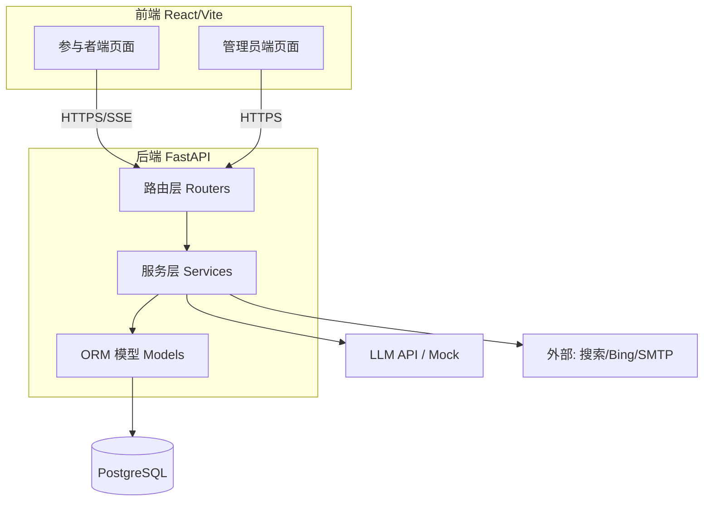
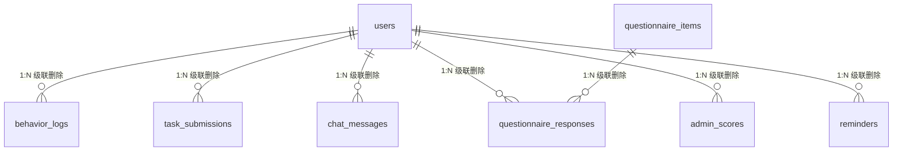

# 网站设计文档

> **文档版本**：v2.0（参照飞书开放平台技术文档规范）
> **适用系统**：人机协作决策实验平台（Human–AI Collaboration Decision Experiment Platform）
> **维护人**：研发组
> **最后更新**：2026-08-05
> **配套文档**：《数据库说明书》《开发文档与实验设计差异对照表》

---

## 更新记录

| 版本 | 日期 | 修改人 | 摘要 |
|------|------|--------|------|
| v1.0 | 2026-08-05 | 研发组 | 初版设计文档（按代码实现整理） |
| v2.0 | 2026-08-05 | 研发组 | 参照飞书开放平台技术文档规范重构：补充文档元信息与更新记录、集中名词解释、接口参考采用飞书标准模板（功能说明/前提/限制/请求/响应/错误码）、新增 FAQ 与变更日志，并整合已知偏差清单 |

---

## 1. 概述

### 1.1 项目简介

本平台支撑一项**人机协作决策**的对照实验，核心研究问题是：在不同程度的 AI 辅助下，个体的决策过程、任务绩效与主观体验（信任、自主性感知、满意度等）是否存在系统性差异。

平台提供**参与者端**（完成实验任务）与**管理员端**（监控、评分、导出）两套界面，并采集三类数据进行三角验证：客观行为日志、事后问卷、管理员主观评分。

> 本文档以**实际代码实现**为基准（FastAPI + React + PostgreSQL），旨在为开发维护、实验执行与论文撰写提供一致的系统说明。

### 1.2 名词解释

| 术语 | 说明 |
|------|------|
| H | 纯人工组，无 AI 辅助 |
| SOA | 单智能体组，1 个全能 AI 助理 `soa` |
| MOA | 多智能体组，2 个分工助理：`moa_a` 信息检索专员、`moa_b` 行程编排专员 |
| 单盲 | 参与者不知晓自身所属组别（设计意图） |
| 状态机 | 实验流程的状态转移约束，单向推进、不允许回退 |
| Function Calling | 大模型按预定义工具描述自主选择并调用工具的能力 |
| SSE | Server-Sent Events，服务端向客户端单向流式推送（用于 Agent 流式回复） |
| 八因子评分 | 管理员对最终行程方案的百分制主观评分（7 价值因子 + 环保附加值） |

---

## 2. 整体架构

### 2.1 技术选型

| 层 | 技术 |
|----|------|
| 前端 | React 18 · TypeScript · Vite · Tailwind CSS · Zustand · React Router v6 |
| 后端 | Python · FastAPI · SQLAlchemy 2.0（异步）· asyncpg |
| 数据库 | PostgreSQL 16 / 17 |
| 实时通信 | SSE（Server-Sent Events），用于 Agent 流式回复与执行状态推送 |
| AI Agent | LLM API + Function Calling，含 `MockLLMClient` / `RealLLMClient` 工厂模式 |
| 文档生成 | `python-docx` 程序化生成 `.docx`（HTML 富文本 → 带格式 docx） |
| 景点搜索 | `httpx` + 标准库 `html.parser` 爬取 DuckDuckGo / Bing HTML（无需 API key） |
| 部署 | Docker 全栈编排（PostgreSQL + backend + frontend） |

### 2.2 系统架构图



### 2.3 目录结构

```
travel-experiment-platform/
├── frontend/                  # React + TypeScript 前端
│   └── src/{pages,components,stores,hooks,services,types}
├── backend/app/
│   ├── routers/               # 路由：auth/task/search/document/email/agent/log/admin…
│   ├── services/              # 业务逻辑：auth/document/email/group/agent/search/reminder
│   ├── models/                # ORM 模型（10 张表）
│   ├── schemas/               # Pydantic 请求/响应模型
│   ├── deps.py                # 鉴权依赖注入
│   └── main.py                # 应用入口（含 lifespan：建表/种子/提醒调度器）
├── database/{schema.sql,seed.sql}
└── docker-compose.yml
```

---

## 3. 实验设计

### 3.1 三组对照

| 组别 | 含义 | AI 助理配置 | 工具权限 |
|------|------|-------------|----------|
| **H** | 纯人工 | 无 | 仅前端内置富文本编辑器与表单 |
| **H+SOA** | 单智能体 | 1 个全能助理 `soa` | 搜索/文档/预算/提醒/邮件（5 项） |
| **H+MOA** | 多智能体 | 2 个分工助理：`moa_a` 信息检索专员、`moa_b` 行程编排专员 | `moa_a`：搜索；`moa_b`：文档/预算 |

> 说明：MOA 组中 `moa_b` 仅持「文档生成 + 预算计算」工具，**未**配置提醒与邮件工具，与 SOA 的全能配置存在能力差异（见第 8 节）。

### 3.2 随机分组

- 分组服务 `group_service.assign_group` 在注册（或同意）时写入 `users."group"`。
- 目标：1:1:1 分配，按 `target_sample_size / 3` 计算每组容量上限。
- 算法实质：**最小人数填充法**——在仍有名额的组中，选择当前人数最少者，并列时随机；满额后默认补入最少组。**当前未读取** `system_config.block_size`，故称「区块随机化」与实际算法不符（详见第 8 节）。

### 3.3 实验任务

「杭州 N 日游行程规划」（默认 N=3、预算 1000 元），四项子任务：

1. **景点搜索** —— 检索目的地景点（DuckDuckGo + Bing 实时爬取，失败回退内置 mock 数据）。
2. **文档生成** —— 将规划导出为 Word 文档（内置富文本编辑器，保留排版）。
3. **提醒设置** —— 设定出行提醒（到期由后台调度器自动发送提醒邮件）。
4. **邮件发送** —— 将行程文档发送给指定收件人。

### 3.4 单盲实现说明

分组信息存储于服务端 `users."group"`，前端按组渲染不同界面。但当前 JWT 载荷明文携带 `group` 字段（见第 8 节 P0-1），单盲的保密性需在修复后方可严格成立。

---

## 4. 功能设计

### 4.1 参与者端流程

**状态机**（单向、不可回退）：

```
registered → consented → demo_completed → task_in_progress → task_completed → questionnaire_completed
```

由 `state_machine.py` 的 `VALID_TRANSITIONS` 强制推进，非法转换抛 `ValueError`。

**页面流**：

| 页面 | 路由 | 触发状态变更 |
|------|------|--------------|
| 注册 | `/register` | registered |
| 知情同意 | `/consent` | → consented |
| 演示 | `/demo` | → demo_completed（记录观看时长） |
| 任务 | `/task` | → task_in_progress / task_completed |
| 行程看板 | `/itinerary` | — |
| 问卷 | `/questionnaire` | → questionnaire_completed |
| 完成 | `/complete` | — |

H 组任务页提供富文本编辑器；SOA/MOA 组额外提供 AI 助理对话窗口。

### 4.2 管理员端功能

后台入口 `/admin`，登录后提供：

| 模块 | 功能 |
|------|------|
| 仪表盘（Dashboard） | 实时统计：参与者数、各组分布、任务完成率、平均时长、AI 服务成功率/响应时间、3-sigma 异常检测 |
| 行为日志 | 按参与者/行为类型/时间筛选查询 |
| 参与者管理 | 列表、详情（含 docx 下载）、状态修改、删除 |
| 评分 | 八因子百分制录入，`total_score` 自动计算 |
| 问卷配置 | 题项增删改查、启用/停用、量表与适用分组配置 |
| 系统配置 | 天数/预算/样本量/收件邮箱等参数读写 |
| 数据导出 | 参与者、日志、评分、全量（CSV / XLSX） |
| AI 助理监控 | `openclaw/status` 暂停开关（实验中断） |

### 4.3 核心子系统

**认证与鉴权**

- 密码哈希：bcrypt（`auth_service.hash_password`）。
- Token：JWT（HS256），`ACCESS_TOKEN_EXPIRE_MINUTES=1440`（24 小时）。
- 载荷：`{sub, group, status, role}`，`role` ∈ {user, admin}。
- 依赖注入 `deps.get_current_user` 解析并校验 Token。
- 管理员登录独立接口 `/api/auth/admin/login`。

> ⚠️ 已知偏差：JWT 明文携带 `group`，Base64 可解码，单盲保密性不足（P0-1）。

**分组算法**：见 3.2 节。函数 `assign_group(db, user)` 读取各组计数与容量上限，返回 `ExperimentGroup`。

**状态机**：见 4.1 节。由 `transition_status` 校验合法性。

**AI Agent 系统**

- **架构**：`BaseAgent` 封装 LLM 调用循环：用户消息 → LLM →（工具调用 → 执行 → LLM）* → 最终回复，全程经 **SSE** 流式推送。
- **工厂**：`agent_factory.get_agent(agent_id)` 按 `AGENT_CONFIGS` 构造助理（系统提示 + 工具清单）。
- **工具集（Function Calling）**：`search_attractions` / `generate_docx` / `calculate_budget` / `set_reminder` / `send_email`。
- **干预能力**：参与者可随时中断助理本轮操作；`base_agent.chat` 在「首轮返回后」「每个工具执行前」「二次 LLM 调用前」三处设置取消检查点。
- **对话历史**：每助理保留最近 10 条消息上下文，存入 `chat_messages`。
- **LLM 客户端**：`llm_client.get_llm_client` 工厂，未配置 `LLM_API_KEY` 时回退 `MockLLMClient`。

> 注：设计文档提及对接 OpenClaw（Shell 执行 / 文件操作能力），当前实现以 LLM + Function Calling 的 5 个受限工具替代，OpenClaw 仅作为 Agent 服务的统称（见第 8 节）。

**行为日志采集**

- 前端 `useBehaviorLogger` 统一上报，批量接口 `POST /api/log/batch`。
- 覆盖 16 种 `action_type`（见《数据库说明书》第 7.3 节）。
- 扩展字段记录性能（延迟/成败）、会话元数据、信息检索行为、AI 交互行为。

**八因子评分**

- 由管理员在后台录入 7 个价值因子（0–10）+ 环保附加值（-5~+3）。
- `compute_total` 计算加权汇总并 clamp 至 0–100。
- 权重与 GB/T 18972-2017 派生（见《数据库说明书》第 7.5 节）。

> ⚠️ 已知偏差：评分口径（0–10 × 权重）与实验设计文档给出的「30/25/15/10/5/10/5 区间直接打分」细则不一致，评分员需以代码口径为准（P2，见第 8 节）。

**文档 / 提醒 / 邮件**

- **文档**：`document_service.generate_docx` 支持 `text`/`html` 两种输入，HTML 经 `_HtmlToDocx` 解析为带格式 docx；下载接口 `/api/document/download/{file_name}`。
- **提醒**：`reminder_service` 提供 `create_reminder` 与后台调度器 `send_due_reminders`（每 30 秒扫描到期项，向用户注册邮箱发信；失败重试上限 5 次或遇永久失败则停重试）。
- **邮件**：`email_service.send_email` 按优先级选择 SMTP → Resend → mock；未配置真实后端时仅记录「模拟发送」。

---

## 5. 接口设计

### 5.1 接口总览

前缀统一为 `/api`。主要端点：

| 模块 | 路由前缀 | 关键端点 |
|------|----------|----------|
| 认证 | `/api/auth` | register / login / login-by-email / consent / demographics / me / admin/login |
| 任务 | `/api/task` | config / demo-complete / start / submit / status / **reset** |
| 搜索 | `/api/search` | POST ""（DuckDuckGo+Bing，回退 mock） |
| 文档 | `/api/document` | generate / download/{file_name} |
| 提醒 | `/api/reminder` | POST "" / GET "" |
| 邮件 | `/api/email` | POST send |
| Agent | `/api/agent` | chat（SSE）/ cancel |
| 问卷 | `/api/questionnaire` | items / submit |
| 日志 | `/api/log` | batch / GET "" |
| 管理员 | `/api/admin` | login / dashboard / openclaw/* / logs / participants* / submissions / scores/{user_id} / config / questionnaire-config* / export/* |

> ⚠️ 已知风险端点：`POST /api/task/reset` 当前权限仅「需登录」，可将任意参与者状态回退至 consented 并清空提交与问卷，违背「不可回退」原则（P0-2）；`/itinerary` 与 `/api/document/download` 兜底逻辑存在越权读取风险（见第 8 节）。

### 5.2 重点接口参考（飞书接口模板）

> 下列接口按飞书开放平台接口参考模板组织：`功能说明 → 前提条件 → 使用限制 → 请求 → 响应 → 错误码`。其余端点请参见 Swagger（`/docs`）。

#### 5.2.1 用户注册 — `POST /api/auth/register`

**功能说明**

创建一名实验参与者账户，并在分组逻辑触发后写入实验组与初始状态 `registered`。H 组支持免密注册。

**前提条件**

- 邮箱未被占用。
- 实验处于开启状态（`system_config.experiment_active = true`）。

**使用限制**

- 同一邮箱仅可注册一次（唯一约束）。
- 非幂等：重复提交返回 `409`。

**请求**

基础信息：

| 项 | 值 |
|----|----|
| HTTP URL | `/api/auth/register` |
| Method | POST |
| 权限要求 | 公开（无需登录） |

请求体：

| 名称 | 类型 | 必填 | 描述 |
|------|------|------|------|
| `email` | string | 是 | 登录邮箱，作唯一标识 |
| `password` | string | 否 | 密码（H 组可省略，由 bcrypt 哈希存储） |
| `group` | string | 否 | 预留；实际分组由服务端 `assign_group` 决定，前端传值不生效 |

请求体示例：

```json
{
  "email": "participant01@example.com",
  "password": "secret123"
}
```

**响应**

响应体字段：

| 名称 | 类型 | 描述 |
|------|------|------|
| `id` | string(uuid) | 新用户 ID |
| `email` | string | 注册邮箱 |
| `group` | string | 服务端分配的实验组（H/SOA/MOA） |
| `status` | string | 初始状态 `registered` |

响应体示例：

```json
{
  "id": "a1b2c3d4-...",
  "email": "participant01@example.com",
  "group": "SOA",
  "status": "registered"
}
```

**错误码**

| HTTP 状态码 | 业务 message | 排查建议 |
|-------------|--------------|----------|
| 409 | email already registered | 邮箱已存在，请直接登录 |
| 400 | experiment not active | 实验未开启，联系管理员 |
| 422 | field required / invalid | 请求体校验失败，检查字段 |

#### 5.2.2 任务提交 — `POST /api/task/submit`

**功能说明**

提交四项子任务的完成状态与产物，触发状态 `task_in_progress → task_completed`。

**前提条件**

- 调用方已登录且 `status` 处于 `task_in_progress`。
- 需携带有效 JWT（Header：`Authorization: Bearer <token>`）。

**使用限制**

- 仅允许从 `task_in_progress` 提交一次；重复提交需先 `reset`（注意 P0-2 风险）。
- 四项完成标记由前端上报，后端**未**对 docx/提醒/邮件真实性做服务端校验（见 P0-3）。

**请求**

基础信息：

| 项 | 值 |
|----|----|
| HTTP URL | `/api/task/submit` |
| Method | POST |
| 权限要求 | 登录用户 |

请求头：

| 名称 | 类型 | 必填 | 描述 |
|------|------|------|------|
| `Authorization` | string | 是 | `Bearer <JWT>` |

请求体：

| 名称 | 类型 | 必填 | 描述 |
|------|------|------|------|
| `task1_search` | boolean | 是 | 子任务1：景点搜索完成 |
| `task2_document` | boolean | 是 | 子任务2：文档生成完成 |
| `task3_reminder` | boolean | 是 | 子任务3：提醒设置完成 |
| `task4_email` | boolean | 是 | 子任务4：邮件发送完成 |
| `docx_file_path` | string | 否 | 生成的 Word 文档路径 |
| `reminder_datetime` | string(datetime) | 否 | 提醒时间 |
| `email_recipient` | string | 否 | 收件人邮箱 |
| `duration_ms` | integer | 否 | 任务总耗时（毫秒） |

请求体示例：

```json
{
  "task1_search": true,
  "task2_document": true,
  "task3_reminder": false,
  "task4_email": false,
  "docx_file_path": "outputs/a1b2c3d4/plan.docx",
  "duration_ms": 1234567
}
```

**响应**

| 名称 | 类型 | 描述 |
|------|------|------|
| `status` | string | 提交后状态 `task_completed` |
| `submitted_at` | string(datetime) | 提交时间 |

**错误码**

| HTTP 状态码 | 业务 message | 排查建议 |
|-------------|--------------|----------|
| 401 | unauthorized | Token 缺失或失效，重新登录 |
| 400 | invalid state transition | 当前状态不可提交，需先 `start` |
| 422 | field required | 四个布尔字段必填 |

#### 5.2.3 Agent 对话（流式） — `POST /api/agent/chat`

**功能说明**

与指定 AI 助理发起一轮对话，通过 **SSE** 流式返回推理过程、工具调用状态与最终回复。支持 `soa` / `moa_a` / `moa_b`。

**前提条件**

- 调用方为 SOA/MOA 组登录用户。
- 需携带有效 JWT。

**使用限制**

- 返回类型为 `text/event-stream`，非标准 JSON。
- 单轮保留最近 10 条对话历史（存入 `chat_messages`）。

**请求**

基础信息：

| 项 | 值 |
|----|----|
| HTTP URL | `/api/agent/chat` |
| Method | POST |
| 权限要求 | 登录用户（SOA/MOA 组） |

请求体：

| 名称 | 类型 | 必填 | 描述 |
|------|------|------|------|
| `agent_id` | string | 是 | 助理标识：`soa` / `moa_a` / `moa_b` |
| `message` | string | 是 | 用户输入消息 |
| `session_id` | string | 否 | 会话标识，用于续接上下文 |

请求体示例：

```json
{
  "agent_id": "soa",
  "message": "帮我规划西湖周边两日游",
  "session_id": "sess-001"
}
```

**响应（SSE 事件流）**

事件类型（`event:` 字段）示意：

| 事件 | `data` 含义 |
|------|-------------|
| `token` | 流式文本片段 |
| `tool_call` | 工具调用开始（名称 + 参数） |
| `tool_result` | 工具返回结果 |
| `done` | 本轮结束 |
| `error` | 错误信息 |

**错误码**

| HTTP 状态码 | 业务 message | 排查建议 |
|-------------|--------------|----------|
| 401 | unauthorized | Token 失效 |
| 403 | group not allowed | 当前组别无 AI 助理权限 |
| 400 | agent not found | `agent_id` 非法 |

#### 5.2.4 行为日志批量上报 — `POST /api/log/batch`

**功能说明**

前端统一采集参与者操作轨迹，批量上报至服务端，落库 `behavior_logs`（核心分析数据源）。

**前提条件**

- 调用方已登录。

**请求体**

| 名称 | 类型 | 必填 | 描述 |
|------|------|------|------|
| `logs` | array | 是 | 日志对象数组，每项含 `action_type`/`action_target`/`timestamp`/`page_path` 等（字段详见《数据库说明书》4.2 节） |

**响应**

| 名称 | 类型 | 描述 |
|------|------|------|
| `accepted` | integer | 成功写入条数 |

**错误码**

| HTTP 状态码 | 业务 message | 排查建议 |
|-------------|--------------|----------|
| 401 | unauthorized | 未登录 |
| 422 | invalid action_type | `action_type` 不在 16 种枚举内 |

#### 5.2.5 管理员仪表盘 — `GET /api/admin/dashboard`

**功能说明**

返回实时实验运行概览，供研究员监控进度与异常。

**前提条件**

- 调用方为管理员（`role = admin`）。
- 需携带管理员 JWT。

**响应体字段（摘要）**

| 名称 | 类型 | 描述 |
|------|------|------|
| `total_participants` | integer | 参与者总数 |
| `group_distribution` | object | 各组人数分布 |
| `completion_rate` | float | 任务完成率 |
| `avg_duration_sec` | float | 平均任务时长 |
| `ai_success_rate` | float | AI 服务成功率 |
| `ai_avg_latency_ms` | float | AI 平均响应时间 |
| `anomalies` | array | 3-sigma 异常检测命中项 |

**错误码**

| HTTP 状态码 | 业务 message | 排查建议 |
|-------------|--------------|----------|
| 401 | unauthorized | 管理员 Token 失效 |
| 403 | forbidden | 非管理员账户 |

#### 5.2.6 八因子评分提交 — `POST /api/admin/scores/{user_id}`

**功能说明**

管理员对指定参与者的行程方案录入八因子评分，`total_score` 由 `compute_total` 自动汇总。

**前提条件**

- 调用方为管理员。
- `user_id` 存在且已完成任务。

**请求体**

| 名称 | 类型 | 必填 | 描述 |
|------|------|------|------|
| `scenic_score` | integer | 是 | 观赏游憩价值（0–10） |
| `historic_score` | integer | 是 | 历史文化价值（0–10） |
| `rarity_score` | integer | 是 | 珍稀奇特程度（0–10） |
| `scale_score` | integer | 是 | 规模与体量（0–10） |
| `integrity_score` | integer | 是 | 完整性（0–10） |
| `fame_score` | integer | 是 | 知名度/影响力（0–10） |
| `season_score` | integer | 是 | 适游期/使用范围（0–10） |
| `eco_score` | integer | 否 | 环保附加值（-5~+3） |
| `quality_score` | integer | 否 | 综合完成质量（0–10） |
| `notes` | string | 否 | 评分备注 |

**错误码**

| HTTP 状态码 | 业务 message | 排查建议 |
|-------------|--------------|----------|
| 409 | score exists | 已存在评分，upsert 将覆盖（影响 ICC，见 P0-4） |
| 422 | out of range | 因子取值超出 0–10 范围 |

> 本项目采用 HTTP 状态码 + 业务 `message` 表达错误，未定义飞书式的细分错误码体系。

### 5.3 已知风险端点

- `/itinerary` 为公开无鉴权路由。
- `/api/document/download` 兜底「全局最新 docx」存在跨用户越权读取风险。

---

## 6. 数据设计

完整表结构、字段约束、索引、枚举常量与种子数据见配套《数据库说明书》。此处给出概览：

- **中心实体** `users`，下游 6 张子表（`behavior_logs` / `task_submissions` / `chat_messages` / `questionnaire_responses` / `admin_scores` / `reminders`）均以 `user_id` 外键级联删除。
- **问卷**：`questionnaire_items`（题库）一对多 `questionnaire_responses`（作答）。
- **配置**：`system_config`（键值对）、`admin_users`（管理员）为独立实体。



---

## 7. 非功能性需求

- **安全**：JWT + bcrypt；管理员独立账户；CORS 由 `CORS_ORIGINS` 白名单控制（默认 `localhost:5173/3000`）。
- **隐私**：行为日志含 `user_agent`、屏幕分辨率等元数据，属研究必要采集；提醒/邮件使用参与者注册邮箱。
- **数据隔离**：删除用户级联清除其全部数据，避免孤儿记录。
- **可观测**：管理员仪表盘提供完成率、AI 成功率/响应时间、3-sigma 异常检测。
- **部署**：Docker 全栈编排；开发期 HTTP（localhost），生产建议 TLS。

---

## 8. 实现现状与已知偏差

本节汇总当前实现与实验设计意图的主要差异（完整 45 条见《开发文档与实验设计差异对照表》）。按优先级标注：

### P0（直接威胁实验效度，建议优先修复）

| 编号 | 问题 | 位置 |
|------|------|------|
| P0-1 | JWT 明文携带 `group`，Base64 可解码 → 单盲可被绕过 | `auth_service.create_user_token` |
| P0-2 | `POST /api/task/reset` 权限仅「需登录」，可回退状态并清空提交/问卷 | `routers/task.py` |
| P0-3 | 四项子任务完成度由前端传布尔值，后端零校验 → 客观指标失真 | `routers/task.submit_task` |
| P0-4 | `admin_scores` 为 upsert 单记录，第二评分员覆盖第一人 → ICC 无法计算 | `routers/admin.py` |
| P0-5 | 16 种 ActionType 无 accept/modify/reject/ignore 语义 → 「意图—行为差距」无直接指标 | `models/behavior_log.py` |

### P1/P2（设计一致性 / 口径问题）

- **预算 1000 vs 3000**：seed 与 Agent 提示均为 1000，与实验设计文档「3000 元」不符。
- **分组算法名不副实**：称「区块随机化 block_size=6」，实际为最小人数填充，`block_size` 参数未被读取。
- **未对接 OpenClaw**：实际为 LLM + 5 个受限工具，OpenClaw 降格为统称。
- **缺人工确认闸门**：`set_reminder`/`send_email` 由 Agent 在工具循环中直接执行，无「预览→确认」环节，可能污染「感知自主性」构念。
- **问卷缩水且量表混用**：实际 15 题（设计 19~20），信任构念用 5 级而非 7 级，同卷 5/7 级混用；任务负荷 3 道自拟题未覆盖 NASA-TLX 六维。
- **八因子评分口径冲突**：代码 0–10×权重，设计给的是 30 分制区间打分细则，评分员需以代码口径为准。
- **MOA 组工具能力不对等**：`moa_b` 无提醒/邮件工具，与 SOA 全能配置不一致。

### 权限风险端点

- `/itinerary` 为公开无鉴权路由。
- `/api/document/download` 兜底「全局最新 docx」存在跨用户越权读取风险。

### 文档遗漏（代码已实现，补写文档即可）

演示观看时长、综合完成质量评分（`quality_score`）、3-sigma 异常检测、AI 服务成功率与响应时间——代码均已实现，原开发文档未记载。

---

## 9. 附录

### 9.1 运行环境

| 依赖 | 版本要求 |
|------|----------|
| PostgreSQL | 16 / 17 |
| Python | 3.11+ |
| Node.js | 18+ |
| 关键环境变量 | `DATABASE_URL` / `SECRET_KEY` / `LLM_API_KEY` / `SMTP_*` / `EMAIL_BACKEND` / `CORS_ORIGINS` |

启动顺序：PostgreSQL → backend（`uvicorn app.main:app`）→ frontend（`npm run dev`）。后端 `/docs` 提供 Swagger 文档。

### 9.2 常见问题 FAQ

**Q1：实验进行中想重置某参与者数据，怎么做？**
A：目前 `POST /api/task/reset` 仅校验登录，可将任意参与者回退至 `consented` 并清空提交与问卷（即已知风险端点 P0-2）。正式实验前建议将该接口改为管理员专用。

**Q2：如何新增一道问卷题？**
A：在《数据库说明书》8.2 节的 `questionnaire_items` 种子中追加记录（指定 `construct`/`scale_level`/`applicable_groups`），或通过管理员端「问卷配置」界面操作。

**Q3：如何配置真实邮件发送（而非 mock）？**
A：设置 `EMAIL_BACKEND=SMTP`（或 `resend`）并填写 `SMTP_*` 环境变量；未配置时 `email_service` 仅记录「模拟发送」。

**Q4：双评分员如何避免互相覆盖？**
A：当前 `admin_scores` 为单记录 upsert，`scored_by` 单值，第二位评分员会覆盖第一位（P0-4）。如需 ICC 分析，需改为 `(user_id, scorer)` 联合唯一并增加 `score_round` 字段。

### 9.3 相关文档

- 《数据库说明书》—— 10 张表结构、枚举常量、种子数据
- 《开发文档与实验设计差异对照表》—— 45 条实现与设计差异明细
- `7_21实验网站设计.docx` —— 实验原始设计意图
